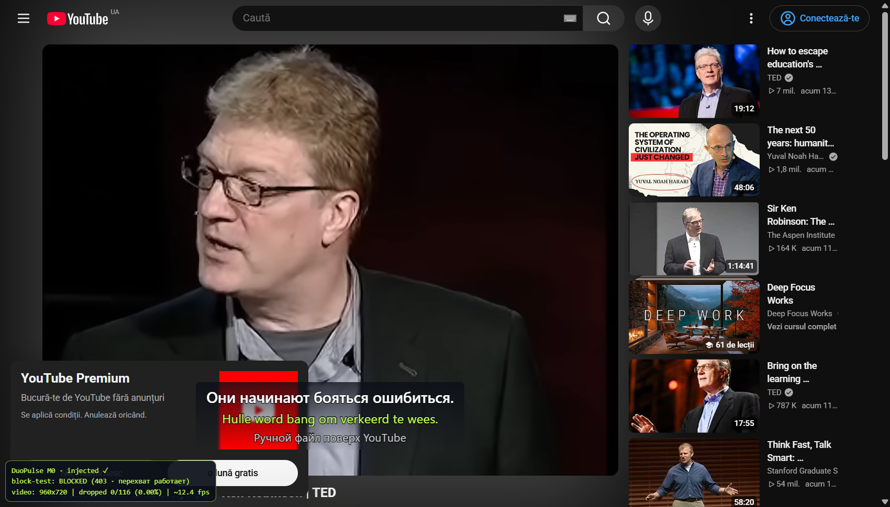
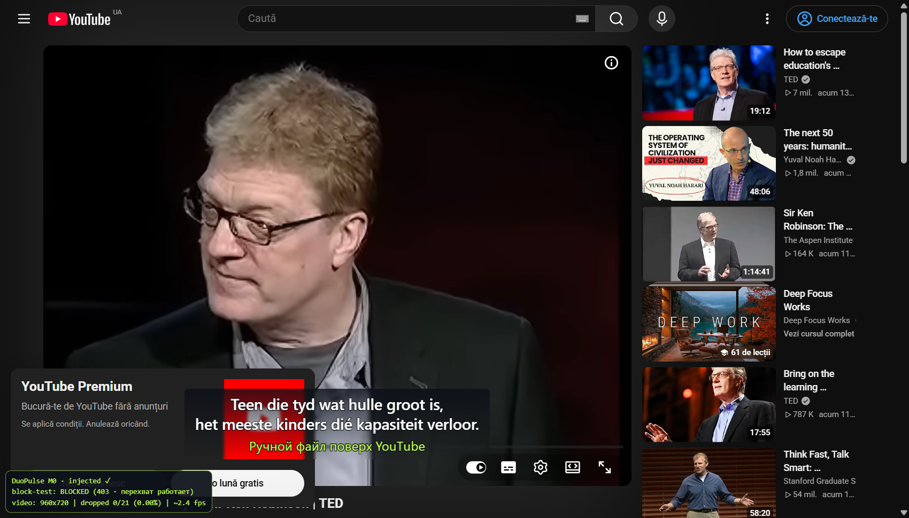
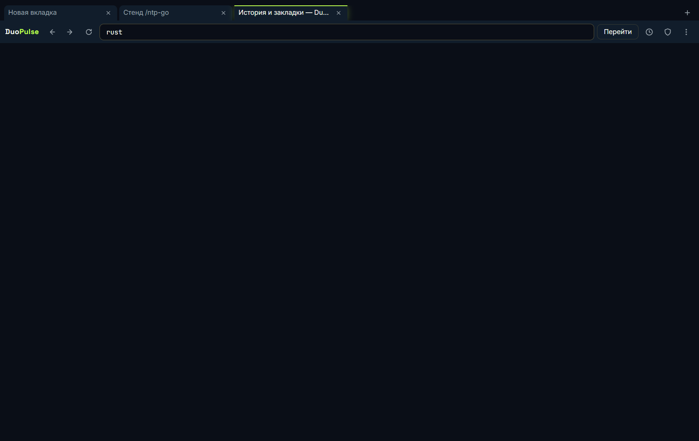
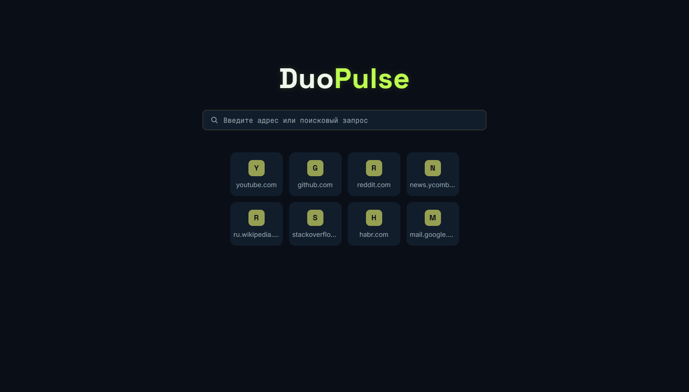
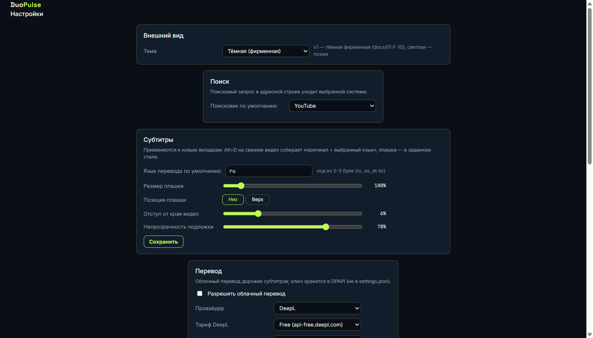

# DuoPulse

> **Быстрый браузер для видео: многоязычные субтитры и полный звук 5.1/7.1.**

DuoPulse — настольный браузер (Windows-first) для повседневной работы в интернете
и просмотра видео на YouTube и других платформах. Четыре принципиальных
требования: скорость, многоязычные субтитры (2–3 дорожки одновременно),
многоканальный звук 5.1/7.1 без сведения к стерео и доступ к заблокированным
сайтам средствами самого браузера (внешний прокси SOCKS5/HTTP — уже готов,
встроенный WireGuard-клиент с split-tunnel — этап M6).

> **English:** DuoPulse is a Windows-first desktop browser built around video:
> 2–3 simultaneous subtitle tracks in different languages, true 5.1/7.1 surround
> sound, plus a password manager and bookmark sync. Built on Tauri 2 (Rust) +
> TypeScript. A portfolio project of the human + AI freelance duo —
> [duet.barter.pp.ua](https://duet.barter.pp.ua).

Текущая версия — **0.1.9**. Проект в разработке (этап M6 «VPN и доступ
к заблокированным сайтам»),
подробный статус — в разделе [«Статус этапов»](#статус-этапов) и
[CHANGELOG.md](CHANGELOG.md).

## Скриншоты

| Двойные субтитры на YouTube (оригинал + перевод) | Смешанный набор: дорожка платформы + свой `.srt` |
|:---:|:---:|
|  |  |

| Фирменный тёмный хром | «Новая вкладка» | Настройки |
|:---:|:---:|:---:|
|  |  |  |

Скриншоты снимаются e2e-стендами приёмки автоматически (папки `e2e/*`); там же
прочие шоты: три строки субтитров
([e2e/subtitles/shot-overlay-3rows.png](e2e/subtitles/shot-overlay-3rows.png)),
история, диагностика, вкладки, блокировщик «до/после», английские субтитры
оригинала поверх русской озвучки в плеере кино-сайта
([e2e/subs/embed-subs.png](e2e/subs/embed-subs.png), duopulse-199).

## Возможности

| Возможность | Что даёт | Статус |
|---|---|---|
| **Многоязычные субтитры** | 2–3 дорожки одновременно: оригинал, переводы платформы (включая ~156 языков машинного перевода YouTube), свои файлы; субтитры включены по умолчанию: новое видео с дорожками само поднимает дефолт «оригинал + перевод по правилу» (duopulse-196/216: русский или украинский оригинал → английская строка, любой другой язык — en/ro/ar/fr/… — → русская; кнопка «duo»/Alt+D — тот же дефолт или последний набор) и открывает нативное меню настроек (видимое поверх страницы на любой вкладке, карточка duopulse-087): язык видео, перевод (платформа или облако) и перевод по умолчанию для новых видео, показ субтитров включён ПО УМОЛЧАНИЮ на каждом новом видео независимо от прошлых выключений (duopulse-203; выключение действует на текущее видео, новые снова стартуют с субтитрами — память вкл/выкл осталась только согласием автоперевода своих файлов), потолок строки плашки: гигантские реплики-«окна» автосубтитров и переводов (музыкальные клипы) показываются хвостом ≤3 строк — плашка не закрывает видео (duopulse-200), позиция/размер/вид плашки (пресеты «Фирменный / Ч/б контраст / Жёлтый TV»), порядок строк по правилу: ПЕРЕВОД — всегда верхней строкой при любом языке видео (русское видео — английская строка сверху, иностранное — русская; оригинал — нижней строкой, duopulse-206), ручная перестановка строк одним кликом (duopulse-181), гарнитура и быстрые палитры цветов строк оригинала/перевода — эффект сразу на видео, точные пипетки — в полной панели; стиль, сохранённый на странице настроек, применяется и к уже открытым видео сразу (а не только к новым вкладкам), сдвиг синхронизации, свои субтитры, ASR и вход на страницу всех настроек; полная панель субтитров (все контролы: языки, перевод, вид, сдвиг) — отдельным окном НАД страницей на любой вкладке, пункт «Полная панель субтитров…» (карточка duopulse-090); языки свободно комбинируются, порядок строк и точная подгонка вида — на странице субтитров; на видео с несколькими озвучками (мульти-даб) язык оригинала — по первому аудиотреку плеера (оригинальная озвучка), а не asr-дорожка дубля (duopulse-159); на видео без asr и мульти-даба (все дорожки ручные, язык оригинала YouTube не отдаёт — напр. клипы VEVO) — рекомендация плеера defaultCaptionTrackIndex при отличии от языка интерфейса страницы, иначе en-дорожка прежде первой (порядок дорожек у YouTube нестабилен, duopulse-184) | ✅ готово |
| **Свои субтитры на любом сайте** | drag&drop 1–3 файлов `.srt`/`.vtt` на страницу с видео; файловые дорожки — полноправные участники набора, смешиваются с дорожками платформы; облачный перевод файловой дорожки — тем же конвейером, что платформенной (duopulse-177); цель автоперевода — то же правило дуо (русский/украинский файл → en, прочие → ru, duopulse-196/216) | ✅ готово |
| **Дорожки плееров кино-сайтов** | фильмы в кросс-доменных плеер-фреймах (uakinogo.io → api.embf.net, дефолтный таб → cinemar.cc и др.): дорожки `.vtt` из инлайн-конфига плеера embf («Eng. full» — оригинальный английский, укр./рус. полные и форсированные) или из ответа API cinemar (перехватывает агент фрейма; субтитры у cinemar принадлежат дубляжу — дефолтный дубляж может идти без них, смена дубляжа приносит дорожки и сама поднимает показ, duopulse-225) сами попадают в набор — русская озвучка + английские субтитры, выбор и перевод дорожки облаком — как на YouTube; дуо на кино-плеерах включено по умолчанию: оригинал поднимается сам, перевод облаком по правилу (русский/украинский → en, прочие → ru, duopulse-196/216); ручной `.srt`/`.vtt` можно бросить прямо на окно плеера (дроп внутрь фрейма раньше терялся, duopulse-199) | ✅ готово |
| **Облачный перевод дорожек** | DeepL / Google Translate / LibreTranslate: «+ перевод в… (облако)» переводит дорожку-оригинал целиком (батчинг с контекстом), SQLite-кэш — повторный просмотр без сети; офлайн — бейдж «перевод недоступен» и автоповтор при появлении сети | ✅ готово |
| **Перевод выделенного текста** | выделил текст → правый клик → «Перевести выделение (на ru)» — пункт нативного контекстного меню страницы (как расширения-переводчики в Chrome); рядом с выделением всплывает бабл: перевод + оригинал + определённый язык, язык меняется селектом в бабле (15 языков), выбор запоминается и ведёт подпись пункта меню; движок — бесплатный эндпоинт Google (без ключей и настроек, карточка duopulse-098) | ✅ готово |
| **Перевод всей страницы** | «Перевести страницу…» в меню «⋮» и пункт контекстного меню — вся страница переводится на выбранный язык, как в Chrome (карточка duopulse-244): текстовые узлы документа едут пачками в бесплатный Google-эндпоинт (gtx, без ключей), перевод применяется на месте с сохранением оригиналов; бар сверху — смена языка селектом, «Оригинал» (вернуть исходный текст) и закрытие (перевод остаётся); динамически добавленный контент дочитывается сам (MutationObserver); пункты контекстного меню и цель по умолчанию запоминают последний выбор. Мобильная ветка (duopulse-245): пункт «🌐 Перевести страницу…» в «⋮»-меню web-оверлея — пейлоад assets/duopulse/page-translate.js, тот же UX (бар/15 языков/«Оригинал»/дочитка), транспорт — веб-фетч gtx прямо из страницы (браузерный TLS-профиль System WebView обходит бот-блок, duopulse-208) | ✅ готово (десктоп + Android web-оверлей) |
| **Субтитры из речи (ASR)** | видео без дорожек: «Распознать речь (ASR)» в меню кнопки «duo» транскрибирует аудио (YouTube — из player-ответа, «голое» `<video src>` — напрямую) в дорожку-оригинал `asr:<lang>`; гибрид: локальный whisper.cpp (приватно, офлайн, модель скачивается по требованию) или OpenAI-совместимое облако (OpenAI/Groq/свой сервер, ключ в DPAPI); прогресс фазами, SQLite-кэш повторных просмотров, отмена уходом с видео | ✅ готово |
| **Загрузка видео, музыки и субтитров** | кнопка «⬇» в адресной строке (карточка duopulse-118): панель «Скачать» — видео с выбором качества (лучшее/1080p/…/360p), только музыка (m4a без перекодировки или mp3), субтитры выбранным языком (дорожки YouTube + ~156 машинных переводов, `.srt`, либо чекбоксом «без временных меток» — чистый текст: построчно, без пустых строк-разделителей и служебных пометок — звуковых `[Музыка]`, тегов `<i>`, нот ♪, стрелочек `>>` смены диктора, лишних пробелов; duopulse-130/224); имя файла субтитров — по тем же правилам, что видео/музыка (duopulse-224); видео и музыку можно кусками — фрагмент «мм:сс → мм:сс» (вырезать любимые песни из концерта); имя файла — «исполнитель - трек» (метаданные музыки), иначе очищенный заголовок: без кода видео и служебных слов в скобках вроде «(Official Video)» (duopulse-150); движок yt-dlp (поддерживает 1800+ сайтов, не только YouTube) + ffmpeg + deno докачиваются в профиль автоматически при первом использовании (~150 МБ, один раз, с прогрессом); субтитры берутся проверенным путём контент-адаптера (PO-токен плеера, как у показа плашки), при блокировке браузерной сессии — фолбэк yt-dlp; сессия YouTube приложения передаётся yt-dlp (куки профиля, AES-GCM/DPAPI-расшифровка) — анонимные загрузки на «подмоченных» IP не ловят бот-чек; каталог загрузок — настройка (иначе системная «Загрузки»), прогресс/скорость/отмена — живьём в панели, несколько заданий параллельно | ✅ готово (Windows-десктоп) |
| **Индикатор файловых загрузок** | скачивание файла по клику на ссылку (музыка, архив, документ) больше не проходит молча: кнопка «⬇» у адресной строки зажигает пульсирующую точку, подсказка дополняется «— скачивается: N» (карточка duopulse-158, пожелание Артёма; duopulse-222: индикатор слит с основной кнопкой «⬇» — прежняя вторая кнопка-«домик» справа открывала ту же панель «Скачать» и путала «две кнопки делают одно и то же»); клик открывает панель «Скачать» со секцией «Файлы» сверху: имя файла, скачано байт и скорость живьём (~2 раза/с), бегущая полоска без процентов (размер заранее не известен), итог — «готово · размер», клик по готовой строке — показать файл в Проводнике; прерванная — «загрузка прервана»; файлы кладутся в настроенный каталог загрузок (как у медиа-панели), при совпадении имени — «имя (2)»; пульс гаснет по завершении, список файлов живёт в панели до конца сеанса; на внутренних страницах (duopulse://) кнопка появляется только пока что-то качается; медиа-задания панели «⬇» тоже зажигают индикатор | ✅ готово (Windows-десктоп) |
| **Синхронизация субтитров** | сдвиг ±10 с (Alt+[ / Alt+], Shift+колесо, слайдер панели) с HUD-индикацией; seek-устойчивость, покадровая точность | ✅ готово |
| **Просмотр PDF-файлов** | DuoPulse — системный просмотрщик PDF: на Windows установщик регистрирует ассоциацию `.pdf` («Открыть с помощью → DuoPulse», двойной клик — файл открывается вкладкой со встроенным просмотрщиком WebView2 — зум/поиск/печать; файл при живом браузере открывается в нём же, второй экземпляр не поднимается); на Android — intent-filter `application/pdf` («Открыть с помощью» из файловых менеджеров), документ рисуется встроенным просмотрщиком на pdf.js (листание, зум, имя файла в адресной строке); если менеджер прислал файл без разрешения на чтение (content-URI без grant) — понятная подсказка вместо текста исключения (duopulse-141); карточки duopulse-119/141 | ✅ готово |
| **Локальное видео как в плеере** | DuoPulse играет скачанные фильмы без внешнего плеера: пункт «Открыть видео…» в меню «⋮» (нативный диалог, mp4/m4v/mkv/webm — контейнеры, которые реально декодирует движок), перетаскивание файла в окно — дроп на страницу открывает ролик в этой вкладке, дроп на хром (строка вкладок/панели) — в новой вкладке, а не вместо интерфейса; установщик регистрирует ассоциации `.mp4/.m4v/.mkv/.webm` — двойной клик в Проводнике и «Открыть с помощью → DuoPulse» открывают файл вкладкой (при живом браузере — в нём же, второй экземпляр не поднимается, как у PDF); субтитры — дропом до 3 файлов .srt/.vtt и сдвигом Alt+[/Alt+]; перевод на лету: фильм + .srt чужого языка = вторая строка-перевод сразу (язык файла — из имени фильм.en.srt, цель — язык перевода из настроек; тот же конвейер облака с кэшем, что на платформах; запуск — только при включённом duo, снял строку — за это видео не вернётся; в панели «Языки» файловая дорожка — как оригинал платформы, duopulse-177) (проверено живым стендом duopulse-172: H.264/HEVC/VP9/AV1 играют; честные ограничения: AVI и звук AC-3/DTS не поддерживаются движком — карточка duopulse-176); на Android (duopulse-179) — DuoPulse появился в «Открыть с помощью» видео (intent-фильтры mp4/m4v/mkv/webm со своими MIME), файл из контентного URI копируется в cache/video и играет экраном-проигрывателем <video> поверх вкладок (контролы WebView, перемотка — через собственный протокол mobilevideo с Range/206-кусками; без grant — понятная подсказка как у PDF; неподдержанный контейнер — честная ошибка «формат не поддержан»); смоук релиза — e2e/mobile/video-release-smoke.mjs | ✅ готово (десктоп + Android) |
| **Встроенный блокировщик** | движок Brave (adblock-rs): сетевая фильтрация до загрузки ресурса, списки EasyList/uBO с суточным обновлением, косметика + скриптлеты `##+js` (ранняя синхронная инъекция — до инлайн-скриптов страницы; клиентская YouTube-реклама срезана), перезапись тел ответов `$replace` в духе uBO (самофетч через локальный роутер + замены в теле до парсинга; живые правила uBO, счётчик переписанных в adblock.status), белый список per-site, живой счётчик (панель «⋮» — окном над страницей, карточка duopulse-090); SSAI-преролл YouTube (вшит сервером в поток, сетью не срезается) — мгновенный скип **под затемнением и без звука** (карточка duopulse-089): пока плеер под чёрным экраном прожигает рекламную секцию (seek-цикл + разгон ×16 + автоклик родного «Пропустить», при неудаче — тихая перезагрузка-лотерея ≤2), реклама не видна и не слышна — как будто её нет; ручной резерв — кнопка «Пропустить рекламу» (076/080); точечные встроенные списки вне YouTube: кино-сайты (188/190, 227) и туб-сайты — преролл/попапы xhamster (140/197); кликундеры кино-/туб-сайтов не съедают клики и при выключенном блокировщике: погашенные WebView2 не-http попапы `window.open` получают живую заглушку + отложенный focus, и скрипт сайта доигрывает свою компенсацию клика, как в Chrome (227) | ✅ готово |
| **Навигация как в браузере** | полный адрес видео в адресной строке даже при SPA-переходах YouTube (выделяется и копируется); адресная строка живо следует за вкладкой и после её ввода: Enter (адрес или поиск) уводит фокус странице, и строка показывает адрес открывшейся страницы, а не оставшиеся ключевые слова поиска — и после клика по результатам поиска тоже (duopulse-187), «открыть в новой вкладке» — правой кнопкой, target=_blank и средней кнопкой — вкладка открывается **в фоне**, без перехода на неё (карточка duopulse-088: переключение — только вручную, кликом по вкладке); новая вкладка — кнопка «+», Ctrl+T из любого места и правый клик по панели вкладок (нативное меню «Новая вкладка», карточка duopulse-086); вкладки переставляются мышкой — зажатая левая кнопка тянет вкладку, неоновая кромка отмечает место вставки (дроп правее последней — в конец), порядок пишется в сессию, активная вкладка и контент не меняются (duopulse-205); звёздочка избранного рядом с адресом + Ctrl+D из любого места; меню звёздочки показывает заголовок и адрес закладываемой страницы (duopulse-187); выпадающие панели хрома (меню «⋮», прокси, VPN, duo, подсказки адресной строки) — окнами над страницей, не уходят под контент (карточка duopulse-090); режим инкогнито — Ctrl+Shift+N из любого места, пункты меню «⋮» и контекстного меню вкладки («Открыть копию в инкогнито»), значок-шпион в таб-баре: изолированная среда WebView2, история и сессия не пишутся, ссылки из приватной вкладки открываются тоже в инкогнито, куки/кэш стираются при закрытии последней приватной вкладки (карточка duopulse-096) | ✅ готово |
| **Группы избранного** | несколько групп закладок (закладка может состоять в нескольких группах или без группы): создание/переименование/удаление на странице управления, выбор группы при добавлении со звёздочки (нативное меню над страницей + «Новая группа…» → страница управления), перетаскивание закладки мышью на чип группы — перекладывание между группами (из вида группы — перенос: убрать из текущей и добавить в целевую), порядок вручную drag&drop или сортировка по имени/дате, метки групп в подсказках omnibox; **вложенные подгруппы до 3 уровней** (карточка duopulse-151): «+ подгруппа» в панели группы и long-press чипа на мобильном, чипы групп деревом с отступом, перетаскивание чипа группы на другую — вложить, на «Все» — в корень (циклы и 4-й уровень пресекаются), удаление родителя уносит поддерево (закладки живы), меню папки и звёздочки показывают иерархию, синк Aila переносит родителей по именам, а снятие закладки с прежней группы (перенос в подгруппу) — надгробием членства по времени, иначе облако возвращало ссылку в родительскую группу — «перенос» выходил копией (duopulse-233); **строка закладок под адресной строкой, как в Chrome** (карточка duopulse-143): основные закладки — чипами с бейджем-буквой домена, группы — папками, наведение на папку (или клик) открывает нативное меню с её закладками (подгруппы — подменю, duopulse-151), выбор пункта — переход, средний клик по чипу — новая вкладка, перетаскивание чипа на папку — перекладывание закладки в группу папки, пустое избранное строку прячет; **drag&drop и панель папки** (карточка duopulse-147, пожелание Артёма): чипы меняются местами перетаскиванием (порядок пишется в «Избранное», безгрупповые чипы усыновляются группой), папки переставляются среди сестринских или вкладываются в другие папки перетаскиванием, меню папки — панель-webview с бейджами-доменами: закладки перетаскиваются внутри папки (первая перестановка включает ручной порядок) и на подгруппы, спуск в подгруппу с крошкой «‹», бейджи-буквы с градиентом; **фавиконы сайтов и ровная панель папки** (карточка duopulse-155, пожелание Артёма): чипы строки и строки панели показывают настоящую иконку сайта — как в больших браузерах (duopulse-161, пожелание Артёма): Core разбирает `<link rel=icon>` в HTML страницы (фолбэки /favicon.ico, /apple-touch-icon.png), качает по сетевому пути WebView2 (SOCKS-роутер) и отдаёт data-URL, кэш по хосту в профиле (позитив 30 дней, «иконки нет» — 7); нет иконки/оффлайн — бейдж-буква как раньше, панель папки открывается точной высоты по содержимому (крошка/подгруппы/закладки — без пустого поля внизу), реальное перетаскивание мышью починено (OLE-перехватчик drop-событий wry глушил HTML5 drag&drop во всех webview — чип в папку, порядок и файловый дроп на страницы); **удаление, перенос между группами и новая группа со строки** (карточка duopulse-160, пожелание Артёма): правый клик по чипу — «Удалить» в нативном меню рядом с «Переименовать…», правый клик по строке закладки в панели папки — мини-меню «Переименовать…/Удалить закладку», правый клик по пустому месту строки — «Новая группа…» (пустые папки видны на строке, имя правится инлайн сразу), закладка перетаскивается между группами через webview-границу (чип строки → открытая панель папки, строка панели → папка строки): свой MIME-тип несёт адрес и группу-источник, text/plain — фолбэк; **удаление группы и меню у курсора** (карточка duopulse-163, пожелание Артёма): правый клик по папке — «Удалить группу» в нативном меню (группа уходит с подгруппами, закладки остаются — как на странице управления), нативные меню строки открываются у курсора, а не на положении окна ниже клика; **«Создать раздел…» в панели папки** (карточка duopulse-173, пожелание Артёма): правый клик внутри открытой папки — пункт в мини-меню строки закладки и в меню пустого места панели: создаёт подгруппу внутри этой папки (уникальное имя «Новый раздел», сразу инлайн-правка имени; на 3-м уровне дерева пункт не предлагается); миграция старых закладок и перенос в файле профиля — без потерь; **сортировка из контекстного меню** (duopulse-219, пожелание Артёма): правый клик по пустому месту строки — «Сортировать по алфавиту / в обратном порядке / по дате добавления (новые или старые первыми)» (порядок пишется bmbar_reorder, безгрупповые чипы усыновляются «Избранным»), меню папки — режим живой сортировки группы (вручную/по алфавиту/обратно/по дате), страница управления предлагает те же пять режимов; **«рядом» против «внутрь» и вынос из вложенности** (duopulse-242, пожелание Артёма): дроп папки на папку (строка и панель папки) — краевые зоны: левая треть «рядом слева», правая «рядом справа» (маркер-кромка, group_reorder; чужой родитель — сперва перенос под родителя цели), середина — «внутрь» (group_move) — раньше вся папка значила «внутрь», и «поставить рядом» вкладывало папку внутрь соседки; подпапки в панели папки перетаскиваются (перестановка среди сестёр, вложение в соседку, вынос крошкой «‹ родитель» на уровень выше), правый клик по подпапке — меню «Переименовать… / Переместить на уровень выше / Удалить папку»; папка переносится и через webview-границу (свой MIME-тип: дроп подпапки панели на фон строки — вынос в корень, папка строки в открытую панель — внутрь), дроп папки правее последнего пункта строки — в конец ряда; панель и строка перерисовываются после кросс-webview-переносов | ✅ готово |
| **Менеджер паролей** | локальное хранилище логинов как в Chrome: экран `duopulse://passwords` (пункт «Пароли» меню «⋮») — добавление/правка/удаление, поиск, показать/скопировать пароль, импорт из Google Chrome одной кнопкой (duopulse-183: Local State + Login Data, DPAPI-ключ пользователя + AES-256-GCM; существующие записи не перезаписываются, сводка после импорта); username и пароль хранятся только шифрованными AES-256-GCM, ключ — под DPAPI (привязан к пользователю Windows), работает без аккаунта; сохранение из форм и автозаполнение (этап 2, duopulse-108): сабмит формы логина → бар «Сохранить/Обновить пароль?» под полосой хрома («Никогда для этого сайта» — denylist), бар живёт как бабл Chrome — клики по странице его не закрывают, переключение вкладок он переживает и возвращается с вкладкой кандидата (duopulse-142), автозаполнение по клику на поле с chooser'ом нескольких аккаунтов; duopulse-194: сохранённый вход сам ложится в форму при загрузке страницы (как в Chrome — только видимую пустую форму, не споря с ручным вводом), записи «только пароль» для форм без логина (роутеры вроде 192.168.31.1: бар «Сохранить пароль на …», автозаполнение одного пароля), потерянный ранний запрос логинов переспрашивается по активации поля; инкогнито не сохраняет и не заполняет; синхронизация паролей/закладок через аккаунт Aila — в цепочке этапов duopulse-106 | ✅ готово (цепочка duopulse-106, этапы 1–6): локальный менеджер и живой цикл (duopulse-107/108), серверный API appdata (aila-386/duopulse-109), вход в аккаунт Aila и синк паролей (duopulse-110: PBKDF2-вход как у веб-клиента, серверу — только auth_hash; ключ HKDF(wrap_key) под DPAPI; авто-синк на старте/правках с бэкоффом + кнопка; слияние по (origin, username) — проигравший пароль записью-дублем), синк закладок и групп избранного (duopulse-111: отдельный блоб key=bookmarks с ключом-цепочкой HKDF от ключа паролей — сессии этапа 4 совместимы; объединение по url/имени группы, удаление — надгробиями, повторное добавление побеждает надгробие; членства лечатся по именам групп; без аккаунта — локально, как раньше); мобильная ветка (duopulse-112): блок «Аккаунт Aila» в меню «⋮» — вход PBKDF2 (как на десктопе), синк паролей и закладок с компьютерами, лист паролей с показом/копированием в системный буфер, секреты — AndroidKeyStore (аналог DPAPI), адрес сервера — файлом `aila-server.txt` в профиле (самохостинг/e2e); без входа телефон работает как прежде |
| **Скорость и лёгкость** | холодный старт ~0,8 с, тёплый ~0,4 с, RAM оболочки ~49 МБ (бюджеты docs/04); спящие вкладки — фон простаивает 5 минут → заморозка WebView2 (~1% ядра); беззвучное видео в фоне — на паузу (фон-пауза duopulse-117: 12 вкладок с видео 4,1 → 0,9 ГБ, вкладки со звуком не трогаем); браузер никогда не запускает видео сам (duopulse-195): транспорт дорожек YouTube не трогает плеер на паузе (muted-старт убран — YouTube сам играет «паузу» от программирования), nudge после рекламы уважает паузу, дорожки поднимаются по факту play; сворачивание/разворачивание окна не переставляет вкладки в нулевой размер (без лаг-шторма ресайзов на слабых машинах) | ✅ готово |
| **Внешний прокси SOCKS5/HTTP(S)** | доступ к заблокированным сайтам с уже имеющимся прокси: панель «Прокси» (окном над страницей, карточка duopulse-090), пароль — в DPAPI; применяется мгновенно — через локальный fail-closed-роутер Core, без перезапуска | ✅ готово |
| **Настройки и перенос профиля** | duopulse://settings: внешний вид, поиск, субтитры, перевод, распознавание речи (ASR), звук, прокси, приватность, диагностика (отладочный бейдж M0 на страницах видео — выключен по умолчанию, карточка duopulse-129); экспорт/импорт профиля одним файлом (настройки, закладки, история, кэш переводов и ASR-дорожек, секреты — по явному выбору) | ✅ готово |
| **Установщик и автообновление** | NSIS per-user без прав администратора, пакеты подписаны minisign и проверяются до установки; каналы stable/canary, тихая автопроверка на старте; источник фида GitHub/Aila с автофолбэком, явное «✓ у вас последняя версия» | ✅ готово |
| **Многоканальный звук 5.1/7.1** | без молчаливого сведения к стерео; секция «Настройки → Звук 5.1/7.1» (карточка duopulse-204): диагностика устройства (сколько каналов Windows дала браузеру — стерео/5.1/7.1 и подсказка, где включить), поканальный тест-тон («Все по очереди» проверяет каждую колонку), баланс каналов 0–200% («передние мощнее задних» — как захотите) и режим «применять к видео»: стереозвук видео распределяется на все колонки (центр/саб/тыл тише фронтов, ползунки правят), родные 5.1/7.1-дорожки идут с поканальным усилением; DRM-видео и кросс-доменные плееры не трогаются, выключено (по умолчанию) — звук без обработки | ✅ готово (программно подтверждено [протоколом M0](e2e/m0-results/AUDIO-PROTOCOL.md): 6/8 дискретных каналов, как Edge; финальное прослушивание на колонках 5.1/7.1 — карточка duopulse-006) |
| **Встроенная VPN (WireGuard)** | клиент boringtun + локальный fail-closed-роутер, split-tunnel по доменам, kill-switch, DNS через туннель — без отдельных VPN-приложений | 🔶 этап M6: локальный роутер с fail-closed готов (6.1, e2e 26/26); встроенный WireGuard-клиент готов — импорт `.conf` (ключ в DPAPI), handshake/keepalive/roaming, DNS только через туннель, 1,4–1,9 Гбит/с на loopback-стенде (6.2); split-tunnel готов — режимы off/global/split, правила домен → маршрут редактируются в настройках, DNS строго по маршруту без утечек (6.3); kill-switch готов — смерть туннеля закрывает установленные соединения (не доживают и не уходят напрямую), новые отказывают сразу, статус-события в UI (6.4); панель VPN (окном над страницей — карточка duopulse-090) и индикатор-щит в Navbar готовы — тумблер, сервер, режим, split-правила, живая статистика rx/tx/ping и маршруты сеанса (6.5); маршрутные e2e готовы и в CI — direct/tunnel/split/kill-switch + 1080p через туннель без буферизации на loopback WG-стенде, 22 проверки (6.6) |

История возможностей по датам и карточкам — в [CHANGELOG.md](CHANGELOG.md).

## Установка (Windows)

Дистрибутивы лежат в `builds/` проекта и видны в приложении Aila на закладке
«Скачать» (сканер берёт `.exe`/`.zip` из корня `builds/`; репозиторий на GitHub:
[summonss7/DuoPulse](https://github.com/summonss7/DuoPulse)):

- **`DuoPulse-<версия>-setup-release.exe`** — установщик NSIS: установка
  per-user, **без прав администратора**, языки русский/английский. Тихий режим —
  флаг `/S` (запускать из PowerShell/cmd: в Git Bash «/S» мутирует в путь).
  Обновление установленной копии — `setup.exe /P /UPDATE /R` (пассивно, с
  авто-перезапуском) — так ставит пакеты встроенный автоапдейтер.
- **`DuoPulse-<версия>-portable-release.zip`** — портативная версия (exe +
  WebView2Loader.dll): распаковать и запустить, без установки.
- `duopulse_<версия>_release/` — релизные артефакты: установщик, минисигн-подпись
  `.sig` и манифесты фида обновлений `latest.json` (stable) / `latest-canary.json`
  (tauri-формат; адрес пакета — в канале Aila).

Требования: Windows 10/11 x64 и WebView2 Runtime (в актуальных Windows 10/11
уже есть; установщик предложит установить при отсутствии).

**Автообновление:** раздел «Настройки → Обновления» или пункт меню «Проверить
обновления…». Каналы stable (по умолчанию) и canary; приложение тихо проверяет
обновления на старте, установка — всегда руками; при актуальной версии диалог
прямо показывает «✓ У вас последняя версия» и кто ответил. Найденное
обновление показывает **бар «Появилась новая версия» поверх таб-бара**
(карточка duopulse-127): кнопки «Установить» и «Отмена», «Отмена» скрывает
бар до перезапуска. Дополнительно обновление подсвечивает неоновой точкой
кнопку «⋮» (подсказка кнопки называет
версию) — о выходе версии видно, не заходя в настройки; «последняя версия»,
ошибка сети и установка точку гасят. Пакет проверяется
по minisign-подписи до установки. Источник фида — на выбор: **GitHub (по
умолчанию)** (`summonss7.github.io/duopulse-updates`) или **зеркало Aila**
(`aila.skillcoin.pp.ua/updates/duopulse`); при недоступности выбранного
проверка автоматически уходит ко второму — канал обновлений не зависит от
одного хостинга. Стенды и канарейки используют env `DUOPULSE_UPDATE_BASE`
(подменяет базу выбранного источника; вторая попытка-зеркало остаётся).

Мобильные релизы (`scripts/android-build.sh`) публикуют подписанный release-APK
в канал обновлений Aila тем же издателем `publish-update.cjs` (aila-388): манифест
v2 — то, что показывает 📡-чип «в канале» хаба «Скачать» и проверка обновлений
в самом приложении; notes — последняя запись `CHANGELOG.md`. Debug и неподписанные
APK в канал не идут; неудача публикации — ошибка сборки (канал не должен
молча отставать от релиза).

Десктоп-релиз выходит **в том же сеансе, что и задача, менявшая десктопный код**
(src/, src-tauri/, bridge/, content/) — правило карточки duopulse-120: пока 0.1.16–0.1.20
выходили только мобильными, Windows-канал застрял на 0.1.15 и приложение честно отвечало
«обновлений нет».

Публикация релиза — одной командой `npm run release [-- --notes "что нового"]`:
сборка → фиды → оба канала (зеркало Aila через `D:\Scheduler\tools\publish-update.cjs`,
GitHub Pages — коммит в локальный клон `D:\DuoPulse\duopulse-updates`) → **корень `builds/`
для хаба «Скачать» Aila** (правило карточки duopulse-063: хаб сканирует только
корень `builds/`, поэтому каждый релиз кладёт туда свежий
`DuoPulse-<верс>-setup-release.exe` и убирает устаревшие установщики/портативные
zip — портативная копия не умеет самообновляться и в хабе больше не раздаётся;
шаг `deployHub()` в `scripts/release.mjs`, только release-сборки) →
**обновление локальной портативной копии `C:\DuoPulse\duopulse.exe`** (правило
карточки duopulse-062: каждый выход новой версии обязан обновлять и её —
последний шаг `scripts/release.mjs`; папки нет — шаг пропускается, файл занят —
закрыть DuoPulse и повторить `npm run release -- --deploy-local`). Версия
в заголовке окна берётся из `tauri.conf.json` — тот же источник, что у релиза.

## Статус этапов

План — [ROADMAP.md](ROADMAP.md) (gate-критерии, риски, изменения плана);
детальная карта задач — [docs/05](docs/05-implementation-map.md) §3.

| Этап | Название | Статус |
|---|---|---|
| M0 | Спайк движка | ✅ пройден 08.10.2026 — **GO на Tauri 2 + WebView2**: 1080p60/4K без дропов, Widevine-DRM, инжекция скриптов и сетевой перехват ([протокол](e2e/m0-results/PROTOCOL.md)) |
| M1 | Каркас браузера | ✅ закрыт 13.10.2026 (задачи 1.1–1.8: bridge, вкладки, omnibox, история/закладки, фирменный UI, сессия, внешний прокси); gate «старт < 2 с» — медианы 397/368 мс |
| M2 | Скорость | ✅ закрыт 17.10.2026, gate принят автором (блокировщик + скриптлеты, спящие вкладки, тёплый старт, метрики docs/04, страница «Диагностика») |
| M3 | Многоязычные субтитры v1 | ✅ закрыт 17.10.2026 (gate: двойные/тройные субтитры стабильны на 10 случайных видео, свой `.srt` — на любом сайте) |
| M4 | Перевод | ✅ закрыт 18.10.2026 (gate: перевод 420 реплик за 7,9 с ≤ 30 с; повторный просмотр — из кэша без сети) |
| M5 | Полировка и релиз | ✅ закрыт 21.10.2026: 5.1 настройки + профиль, 5.2 установщик/автообновление, 5.3 приёмочный прогон — приёмка **принята автором 20.10.2026** (P-05 — трактовка «не хуже Chrome/Edge на той же машине», P-08/SABR-старт — карточка CARDS/044 до финального релиза), 5.4 — LICENSE GPL-3.0 + README-финал (карточка duopulse-036); фид обновлений — GitHub Pages. Чек-лист приёмки: метрики P-01..P-04/P-06 в бюджете, сценарии docs/01 §5 — зелёные, поканальный тест 5.1/7.1 отложен (нет устройства вывода, duopulse-006) |
| M6 | VPN и доступ к заблокированным сайтам | 🔶 6.1 локальный SOCKS5-роутер готов (WebView2 → 127.0.0.1 постоянно, fail-closed подтверждён, режимы без перезапуска; e2e/proxy-a 26/26); 6.2 встроенный WireGuard-клиент готов (boringtun+smoltcp, импорт .conf/DPAPI, handshake/keepalive/roaming, контракт v8); 6.3 split-tunnel готов — режимы off/global/split, правила домен → маршрут с редактированием из настроек и персистом, DNS строго по маршруту без утечек (контракт v9); 6.4 kill-switch готов — смерть туннеля закрывает установленные соединения (страница видит обрыв, напрямую ничего не уходит), новые отказывают сразу, статус туннеля — событием в UI (209 тестов); 6.5 панель VPN и индикатор-щит готовы — тумблер/сервер/режим/правила из Navbar, живая статистика rx/tx/ICMP-ping и «Маршруты сеанса» событиями, дисклеймер «только VPN-клиент» (контракт v10, e2e/bridge 29/29); 6.6 маршрутные e2e готовы — стенд e2e/vpn на loopback WG-стенде (22 проверки: direct/tunnel/1080p без буферизации/split/kill-switch), CI-джоба e2e-vpn на каждый коммит. Gate M6 проверен автоматикой; живая приёмка на своём WG-сервере — за автором |
| M7 | Платформы и развитие | 📋 по карточкам-пожеланиям (адаптеры Vimeo и др., импорт профилей Chrome/Edge, локализация UI) |

## Платформы

**Windows (десктоп)** — основная ветка: все возможности из таблицы выше.

**Android (мобильная ветка, этапы duopulse-081..083 — статус MVP)** — Tauri 2
(lib-паттерн src-tauri: десктоп-бинарник не тронут, мобильные зависимости за
cfg-забором). Один WebView; шапка двухрядная (duopulse-105, пожелание
Артёма): верхний ряд — кнопки (⌂, вкладки, инкогнито, duo, ⬇, «⋮»), под ним
адресная строка на всю ширину — адрес открытого видео (канонический watch-URL)
виден целиком, выделяется и копируется долгим тапом, ввод и переход — как
прежде, звёздочка закладки — рядом с адресом. **Вкладки (duopulse-123,
пожелание Артёма)**: несколько видео одновременно — каждое в своём iframe,
кнопка-переключатель с бейджем количества открывает лист вкладок
(переключение, ✕, «+ Новая вкладка», «Закрыть все»), фоновые вкладки на
паузе, «⌂» = новая вкладка (открытые видео остаются в фоне); сессия вкладок
переживает перезапуск приложения — после рестарта вкладки восстанавливаются
(localStorage, в инкогнито не пишется и стирается при входе). **Фоновая музыка (duopulse-218,
пожелание Артёма)**: музыка браузера (встроенный плеер, файлы, web-оверлей)
продолжает играть, когда пользователь ушёл в другое приложение или на домашний
экран — foreground-сервис mediaPlayback с уведомлением «⏸», пока играет медиа
Chromium не узнаёт об уходе окна в фон (щит window-visibility) и рендерер не
замерзает; музыка остановилась — сервис и щит гаснут сами. В фоне продолжает
играть только то, что играло в момент ухода (duopulse-237): из вкладок YouTube
реплей трогает лишь активную — та, которую слушали, — фоновые стоят на паузе
(прежде после возврата из паузы запускались все вкладки разом). Ссылки YouTube
с видео открываются встроенным плеером (`/embed`; duopulse-123: включая
`/shorts/`, `/live/` и music.youtube.com — прежде такие закладки уводили в
системный браузер), где работают главные фичи DuoPulse. Поиск и прочие
адреса открываются в приложении — нативный web-оверлей поверх UI
(duopulse-126: MobileWebHelper; прежде уходили в системный браузер, т.к.
страницы с X-Frame-Options в iframe не встраиваются); в режиме инкогнито
оверлей открывается на **изолированном профиле WebView** (duopulse-211:
куки и хранилища отдельны от основного профиля, профиль стирается при
закрытии оверлея — прежде режим выкидывал все запросы в системный браузер;
на WebView без multi-profile — общий профиль со стиранием следов при
выходе из режима). Голый IP-адрес
(роутер `192.168.31.1` и другие локальные устройства) открывается по
`http` — как в десктопном omnibox (duopulse-154: https-догадка оставляла
панели роутеров «неработающими», у них самоподписанный TLS или его нет). Шапка оверлея — зеркало
стартовой .m-bar (duopulse-202, прежде duopulse-145; duopulse-207 — полный состав
кнопок): два ряда («⌂» домой/лого duoPulse/очки-инкогнито (тот же переключатель,
что на старте — включение закрывает живой общий оверлей, новый откроется уже
на изолированном профиле, duopulse-211)/
«▶ duo» на видео-страницах/«⬇» (на YouTube-видео — плеер с листом аудио/видео/
субтитров, прочая страница — тост-подсказка)/меню «⋮» + омнибокс-поле адреса со
звёздочкой закладки ☆/★ (тот же стор, что у экрана закладок) и круглой GO),
полоса прогресса загрузки и меню
«⋮» — «Главная DuoPulse», «Закладки» (список в основной ветке; duopulse-193),
«☆/★ В закладки» (страницу — в дефолтную группу тем же хранилищем, что у
экрана закладок, повторный выбор снимает; duopulse-193), «Обновить»,
«Вперёд», «Открыть в плеере duo»,
«Копировать ссылку», «Поделиться…», «Открыть в браузере»,
«⚙ Настройки DuoPulse» (полный лист настроек «⋮» основной ветки —
поисковик/язык/аккаунт/VPN/обновления; duopulse-193); ссылки
YouTube-видео из выдачи открываются сразу во встроенном плеере с субтитрами
(без страницы m.youtube с рекламой; duopulse-139), системный «назад»
возвращает из плеера к выдаче. Адресный чип оверлея кликабелен, как
омнибокс (duopulse-192): тап — поле ввода с текущим адресом, GO —
URL-догадка (схема/домен/localhost-IP, как в мобильном омнибоксе) или
поиск Google, YouTube-видео из ввода — сразу встроенный плеер. YouTube в
оверлее по умолчанию ДЕСКТОПНЫЙ (duopulse-210, пожелание Артёма «мобильная
версия вообще не нравится»): десктопный сайт грузится с десктоп-UA
(duopulse-192), m.youtube.com переписывается на www; «клин до конца
сессии», из-за которого дефолт держали мобильным, коренился не в
десктопном сайте — смена userAgentString ГАСИТ идущую навигацию (Android
WebView), и «смерть» следующих навигаций была отменой их сбросом UA:
теперь каждое изменение UA сопровождается собственным перезапуском адреса
(loadWithUa), переход google.com/goto → YouTube (302, стартует мимо
хуков) и уход с YouTube живут. Переключение версий — пункт «Мобильная
версия YouTube»/«Десктопная версия YouTube» меню «⋮» оверлея (переживает
перезапуск); в мобильном режиме действует поведение duopulse-191 (ссылки
`app=desktop` чистятся, m.youtube, мобильный UA) — видео-страницы режим
не касается, их всегда забирает встроенный плеер. Шапка оверлея — зеркало
старта и по иконкам (duopulse-210): ⌂/вкладки(бейдж)/очки/⋮/★/→ —
линейные Canvas-иконки (перенос SVG старта), кнопка вкладок открывает тот
же лист, «⬇» и щит VPN — по живому состоянию старта (хук
__duopulseHeaderState).
Внешние схемы (market:,
mailto:, tel:… — карточка приложения в выдаче) уходят системному Intent,
а не глотаются молча; долгое нажатие адресного чипа — тоже «Копировать
ссылку». **Полный блокировщик в оверлее
(duopulse-144)**: shouldInterceptRequest спрашивает движок десктопа
adblock-rs через JNI (EasyList + uBO + quick-fixes — те же списки, кэш
profile/filters мобильного профиля, суточное фоновое обновление); тип
запроса Android не раскрывает — Core выводит его из URL/Accept; косметика
(hide-селекторы + скриптлеты) — JS-пейлоадом движка на onPageStarted/
onPageFinished; тумблер «Блокировщик рекламы» — в меню «⋮» оверлея и в
настройках мобильной ветки (settings.json, переживает перезапуск), выкл —
  прежнее поведение: лёгкий хост-лист duopulse-139; «▶ duo» —
  то же вручную. Поисковик по умолчанию —
  Google, выбирается в меню настроек «⋮» в шапке (duopulse-102: доступно на
  любом экране, localStorage), как и в настройках десктопа. В том же меню —
  проверка обновлений и версия сборки.
- **VPN/WireGuard: полный паритет с десктопом (duopulse-169/170/171, цепочка
  6–8/8 завершена)** — платформенно-нейтральное ядро десктопа (vpn/wg.rs:
  boringtun + smoltcp, userspace — без TUN-драйвера и прав; UDP-сокеты на
  Android разрешены) компилируется в мобильную либу целиком: импорт
  **текста** `.conf` (приватный ключ — Android Keystore той же парой
  save/load, что пароли; в wg-profiles.json только открытые поля),
  список/удаление/выбор профилей, статус (endpoint, возраст handshake, rx/tx,
  ICMP-пинг), проба `test_connection`, события
  `vpn:state_changed`/`vpn:stats` — формы контракта `vpn.*` десктопа
  (camelCase). Kill-switch — паритет: handshake старше REJECT_AFTER_TIME
  (180 с) → тоннель мёртв, соединения закрываются, новые отказывают сразу,
  напрямую ничего не уходит (fail-closed ядра). Маршрутизация трафика
  приложения (duopulse-170): роутер процесса поднимается стартом приложения
  (SOCKS5 — фетчи Core, HTTP CONNECT/absolute-form — WebView через
  androidx.webkit ProxyController); тумблер тоннеля переключает маршрут без
  перезапуска, внутренние источники UI (*.localhost) идут мимо прокси; фетчи
  Core — через SOCKS5-порт того же роутера; режим/endpoint/rx/tx — секция VPN
  листа «Диагностика». Панель VPN (duopulse-171, этап 8): лист «VPN» из меню
  «⋮» — тумблер тоннеля, живой статус (rx/tx/ping/handshake событиями
  vpn:stats), профили (импорт `.conf` системным SAF-пикером, активный —
  галочка, удаление вместе с ключом Keystore), режимы off/global/split и
  редактор split-правил (персист vpn/split-rules.json — общий с десктопом
  стор, переживает рестарт вместе с автоподъёмом тоннеля
  mobile_vpn_restore), kill-switch виден в статусе внятно («туннель мёртв —
  соединения закрыты»); индикатор-щит в шапке при активном тоннеле
  (сигнальные цвета). Стенды: e2e/mobile/vpn-core-smoke.mjs (ядро, 23),
  vpn-route-smoke.mjs (маршрутизация, 20), vpn-ui-smoke.mjs (полный
  пользовательский цикл через UI c SAF-пикером, 19) — против WG-сервера
  e2e/wg-stand на машине разработчика (эмулятор видит хост как 10.0.2.2).

- **Duo-субтитры и перевод** — кнопка «duo»: оригинал (дорожки видео, включая
  авто) + перевод — готовые дорожки видео или Google (без ключей); цель
  перевода по умолчанию — «Авто», то же правило дуо, что на десктопе
  (duopulse-196/201/216): русский или украинский оригинал → английская
  строка, любой другой язык → русская (раньше дефолт gtx:ru у русского
  видео равнялся языку источника и перевод молча не поднимался —
  соло-оригинал; украинский переводился на русский — duopulse-216);
  субтитры всегда включены: каждое новое видео стартует с дуо даже после
  выключения на прошлом («выкл» панели действует на текущее видео,
  паритет десктопу duopulse-203); явный выбор
  языка/дорожки в панели главнее правила, сохранённый старый дефолт
  мигрирует на «Авто»; панель настроек (языки, кегль 75–300%, позиция,
  сдвиг ±10 с) — мобильная вёрстка с потолком высоты и своей прокруткой:
  шапка с ✕ прилипает к верху листа, раскрытые настройки ASR не выталкивают
  закрытие за экран и не накрывают верхнюю панель (duopulse-208, пожелание
  Артёма: меню настроек субтитров «не забрать»);
  настройки переживают перезапуск; синхронизация с плеером — IFrame Player API;
  ротация сессию не рвёт, а замерзший после сворачивания WebView-плеер
  детектируется и перезагружается с возвратом позиции (дорожки не пересобираются);
  сеть ходит нативно через Rust (allowlist YouTube/Google — команда не открытый
  прокси), парсеры cue — общие с десктопом; перевод Google идёт сперва
  веб-фетчем UI-webview — браузерный TLS-профиль Android WebView не ловит
  бот-блок gtx, который раньше ронял перевод на ureq-профиле Core
  (duopulse-208: «перевод не делает»; веб-транспорт не пошёл — фолбэк на
  Core, HTTP-429 — честный отказ без ретраев). Живучесть конвейера
  (duopulse-210, жалоба «субтитры вообще перестали показываться»): сбой
  загрузки скрипта IFrame API больше не «отравляет» страницу готовым
  отказом — следующее видео переподключает часы заново; отказ загрузки cue
  (429/сеть) виден в панели (последний статус показывается при её открытии)
  и через 9 с автоматически повторяется один раз; снапшот состояния — хук
  __duopulseMobileDuo (e2e). Автосубтитры YouTube — одной
  строкой, пословно по мере произнесения (duopulse-113, общий парсер с
  десктопом; в мобильном канале — с версии 0.1.21).
- **Загрузки с YouTube (duopulse-121 → 122, пожелания Артёма)** — кнопка «⬇»
  на экране видео открывает лист выбора: аудио (m4a/opus с битрейтом и
  размером), видео (144p…1080p MP4 со звуком) и субтитры (`.srt`); прогресс
  в строке статуса, закрытие листа отменяет. Медиа-байты качает fetch внутри
  youtube-iframe (document-start скрипт dl-fetcher.js: googlevideo отдаёт
  файлы только браузерному окружению с youtube-origin, закрытые диапазоны
  по 4 МБ с докачкой), файлы собирает Rust и раскладывает по медиатекам —
  Music/DuoPulse, Movies/DuoPulse, Download/DuoPulse; видео+звук склеивает
  Kotlin MediaMuxer без перекодирования. Список дорожек даёт innertube-клиент
  VISIONOS (прямые url без n-параметра, пробы 12.11.2026: url ANDROID отдают
  лишь первый мегабайт, WEB требуют PO-токен); сессию «посетителя» (куски +
  visitorData) Rust собирает одним GET watch-страницы, при отказе клиента —
  фолбэк на ANDROID-ответ субтитров. Аналог десктопной «⬇» панели
  «Скачать» (duopulse-118: видео/музыка/субтитры/фрагменты).
- **Перевод выделенного текста (duopulse-103)** — мобильный вход в тот же
  gtx-конвейер, что у пункта «Перевести выделение» десктопа (098): long-press
  по выделяемому тексту страницы (адресная строка и пр.; кросс-доменный iframe
  плеера недостижим) → чип «Перевести» у выделения → бабл перевода с
  оригиналом, детектом языка и селектом (15 языков, выбор запоминается);
  «Перевести текст…» в меню «⋮» — лист с полем ввода (текст можно вставить
  откуда угодно) и результатом. Ошибка сети/лимита — честным сообщением.
- **Перевод всей страницы web-оверлея (duopulse-245, паритет десктопа 244)** —
  пункт «🌐 Перевести страницу…» в «⋮»-меню шапки оверлея: пейлоад
  assets/duopulse/page-translate.js (инжекция в каждый документ) собирает
  текстовые узлы, водит пачки бесплатным gtx ВЕБ-ФЕТЧЕМ прямо из страницы
  (duopulse-208: браузерный TLS-профиль System WebView обходит бот-блок,
  ключей и Core-канала не нужно), меняет тексты на месте с сохранением
  оригиналов и пробельного контура. Бар с селектом 15 языков, «Оригинал»/
  «Показать перевод», «×»; динамический контент дочитывается
  MutationObserver'ом, последняя цель — в localStorage. Страница со строгим
  CSP (connect-src без googleapis) честно скажет «Не получилось».
- **Инкогнито (duopulse-096)** — кнопка-шпион в шапке включает приватный
  режим: в приватном режиме не пишутся история посещений и сессия вкладок,
  а куки и хранилища сайтов
  WebView стираются при включении (чистый старт) и выключении (следов не
  остаётся; после убийства процесса дочистит следующий запуск по флагу);
  выбор поисковика в приватном режиме живёт до перезапуска.
- **История посещений, загрузки файлов и Basic-auth оверлея, «Восстановить
  вкладку» (duopulse-156, паритет базовых функций с Windows-версией)** —
  визиты видео-вкладок и страниц web-оверлея пишутся в то же SQLite-хранилище
  history.*, что на десктопе (дедуп 60 с); лист «История» в меню «⋮» —
  группами по дням («Сегодня»/«Вчера»/дата), тап открывает запись, ✕ удаляет
  адрес, «Очистить историю» чистит всё (закладки не трогает), инкогнито не
  пишет; клик по ссылке на файл в web-оверлее качается системным
  DownloadManager (куки/UA сессии, прогресс в шторке уведомлений); страницы
  с HTTP Basic-auth показывают диалог логин/пароль; «Восстановить вкладку»
  в меню «⋮» возвращает последнюю закрытую (стек до 12).
- **Закладки с группами (duopulse-104, пожелание Артёма из 099)** — то же
  хранилище history.*, что на десктопе (SQLite в профиле приложения
  filesDir/profile, тонкая мобильная либа регистрирует команды закладок и
  визитов истории). Экран «Закладки» — со
  стартового экрана и пунктом «Закладки» в меню «⋮» в любой момент, в том
  числе поверх открытого видео («назад» возвращает к видео, а не на старт;
  duopulse-193 — прежде при открытом видео панели закладок было не достать):
  группы-чипы («+» — создать, long-press по чипу —
  переименовать/удалить), список с переименованием/удалением, звёздочка в
  строке адреса открытого видео (duopulse-105; прежде — в ряду кнопок) —
  выбор группы из шита (включая «Новая группа…»),
  имя закладки — заголовок видео из player-ответа. Перекладывание пальцем
  (пожелание Артёма): long-press 350 мс по строке → тяга «призрака» на чип
  группы; из вида группы — перенос, из «Все» — добавление, много-членство
  как на десктопе (099). **Строка закладок под адресом** (duopulse-219,
  пожелание Артёма — «как в windows-версии, по умолчанию включено»): чипы
  основных закладок с бейджем-буквой домена и папки-группы под строкой
  поиска, тап по чипу — переход, по папке — экран закладок в этой группе;
  включается/выключается в меню «⋮» («Закладки под адресом», по умолчанию
  вкл), пустая — скрыта. **Сортировка списка** (duopulse-219): кнопка «⇅» в
  шапке экрана — по алфавиту/в обратном порядке/по дате добавления (новые
  или старые первыми), режим показа сохраняется.
  **Фавиконы сайтов в значках** (duopulse-235, пожелание Артёма — «как в
  windows-версии»): строка списка и чип строки под адресом показывают
  настоящую иконку сайта — команда history.favicon мобильной либы (тот же
  фетчер, что на десктопе: `<link rel=icon>` страницы, фолбэки /favicon.ico
  и /apple-touch-icon.png, кэш по хосту в профиле; сайт не дошёл — повтор
  через 10 минут); пока иконки нет — бейдж-буква цветом домена. Стенд —
  e2e/bookmarks/mobile.mjs.
- **Автообновление (OTA, duopulse-083)** — из единого центра семьи Aila
  (канал `/updates/duopulse/`, как у десктопа): тихая проверка при старте (не
  чаще 10 минут) + кнопка «Проверить обновления» в меню настроек «⋮»
  (duopulse-102; раньше — на стартовом экране); баннер
  «⬆ Доступна версия X» с заметками релиза, скачивание APK с прогрессом и
  сверкой sha256, системная установка; недоступный центр — тихая деградация.
  Скачивание устойчиво к обрывам мобильной сети (duopulse-101): таймаут
  зависшего чтения, до 5 попыток с докачкой Range с места обрыва, уже целый
  файл не качается заново, у ошибки — кнопка «Повторить»; при установке —
  подсказка про Play Protect. Десктоп обновляется как раньше
  (tauri-plugin-updater, latest.json) — ветки не пересекаются.
- **Явная деградация (вне мобильной ветки)**: спящий режим, свои файлы
  субтитров, облачные провайдеры перевода (DeepL/Google API/Libre — ключи в
  DPAPI десктопа), метрики производительности P-01..P-08 (десктопные бюджеты).
  Цепочка паритета duopulse-164–171 закрыла остальное: диагностика, пароли
  (захват/автозаполнение), ASR (облако + локальный whisper), VPN
  (тоннель/маршрутизация/панель). Перевод Google при недоступности сети —
  честное сообщение, показ оригинала не рвётся.

Сборка: `npm run android:build` → APK в `builds/duopulse_<версия>_android_<тип>/`
(debug — universal для эмуляторов, release — подписанный; aarch64 для телефонов,
`aarch64 x86_64` — universal для канала/эмулятора). Установка: APK в хабе
«Скачать» Aila (чип 🤖) или по баннеру обновления прямо в приложении.

## Разработка

```bash
npm install
npm run tauri dev        # dev-сборка: окно браузера
# для e2e-автоматизации (CDP-порт для стендов):
WEBVIEW2_ADDITIONAL_BROWSER_ARGUMENTS="--remote-debugging-port=9222" npm run tauri dev
# релизный NSIS-пакет (setup.exe + .sig + latest.json) → builds/duopulse_<версия>_release/:
npm run release
npm run release -- --debug
# перегенерация TS-типов IPC-контракта после правки Rust-типов:
npm run gen:bridge
```

Требования: Node.js 20+, Rust stable (на этой машине — тулчейн
`x86_64-pc-windows-gnu`, нужны dlltool/windres в PATH), ключ подписи обновлений
`%USERPROFILE%\.tauri\duopulse-updater.key` (генерация:
`npx tauri signer generate -w <файл>`).

E2E-стенды приёмки (Node, релятивные пути от корня; живые — требуют сеть,
adblock-стенды — локальный тест-лист):

```bash
node e2e/bridge/run.mjs       # сквозной IPC-контракт (UI → Core → ответ)
node e2e/tabs/run.mjs         # вкладки: Ctrl+Tab, Ctrl+Shift+T, контекст-меню
node e2e/omnibox/run.mjs      # omnibox + история/закладки, FTS5-подсказки (порт — env E2E_OMNIBOX_PORT)
node e2e/bookmarks/run.mjs    # группы избранного: CRUD, сортировки, dnd, звёздочка, страница управления (порт — env E2E_BOOKMARKS_PORT)
node e2e/style/run.mjs        # сверка фирменного стиля по гайду 06
node e2e/session/run.mjs      # восстановление сессии, ленивость, старт (порт — env E2E_SESSION_PORT)
node e2e/adblock/run.mjs      # сетевой слой блокировщика + метрика P-07
node e2e/adblock/cosmetic.mjs # косметика (селекторы, observer, тумблеры)
node e2e/adblock/scriptlets.mjs   # скриптлеты ##+js
node e2e/adblock/cosmetic-youtube.mjs  # живые списки, YouTube до/после
node e2e/sleep/run.mjs        # спящие вкладки + метрика P-04
node e2e/sleep/p04.mjs
node e2e/perf/run.mjs --prefetch   # P-01..P-03 (старт, RAM)
node e2e/perf/diagnostics.mjs      # duopulse://diagnostics
node e2e/perf/p05.mjs              # дропы кадров 1080p60
node e2e/perf/p06.mjs              # отклик UI
node e2e/perf/p08.mjs              # первый кадр vs контроль (DuoPulse без блокировщика)
node e2e/subtitles/run.mjs    # субтитры: оверлей, .srt, перевод, офлайн, стиль (105)
node e2e/asr/run.mjs          # субтитры из речи: «голое» видео → локальный whisper (10; первый запуск сам собирает движок и качает модель — prepare.mjs, кэш e2e/asr/.cache)
node e2e/youtube/run.mjs      # живой прогон «10 случайных видео» (52)
node e2e/settings/run.mjs     # перенос профиля одним файлом
node e2e/update/run.mjs       # установка/обновление/деинсталляция (нужен npm run release)
node e2e/proxy-a/run.mjs      # локальный SOCKS5-роутер + внешний прокси: fail-closed, режимы без перезапуска (порт — env E2E_PROXY_A_PORT)
node e2e/vpn/run.mjs          # маршрутные сценарии VPN на loopback WG-стенде: direct/tunnel/1080p/split/kill-switch (22; порт — env E2E_VPN_PORT)
```

CI (GitHub Actions, [.github/workflows/ci.yml](.github/workflows/ci.yml)) — на
каждый коммит: vitest на зафиксированных player-ответах + tsc и cargo
fmt/clippy/test (включая маршрутные автотесты Core на loopback WG-стенде
`e2e/wg-stand`), и приёмочный E2E-джоба `e2e-vpn` — стенд `e2e/vpn` на
реальном приложении без внешней сети (весь трафик — 127.0.0.1); живые
e2e-стенды остальных сценариев — локально.

## Технологический стек

- **Оболочка:** Tauri 2 (Rust) + системный WebView2 (Chromium) — быстрый старт и
  малый расход памяти (обоснование и альтернативы —
  [docs/02-architecture.md](docs/02-architecture.md)).
- **UI браузера:** TypeScript + Vite (без фреймворков), фирменные токены стиля.
- **Субтитры:** TypeScript-модуль, инжектируемый в страницы (без сторонних
  расширений), плюс Rust-сервисы парсинга/кэша/перевода.
- **Данные:** SQLite (история, закладки, кэш переводов, метрики) + JSON
  (настройки, сессия, профиль).
- **Обновления:** tauri-plugin-updater, подпись minisign, каналы stable/canary.

## Структура репозитория

```
DuoPulse/
├── README.md               ← вы здесь
├── ROADMAP.md              этапы, gate-критерии, риски, изменения плана
├── CHANGELOG.md            вся история работы (дата-время, что сделано, как проверено)
├── AGENTS.md               протокол работы с карточками задач
├── backup.bat              резервная копия проекта (перед серьёзными изменениями)
├── CODING-STANDARD.md      общий стандарт программирования (канон — D:\Scheduler)
├── (promt.txt)             замороженный архив отчётов — локально, в репо не входит
├── (CARDS/)                карточки задач диспетчера — локально, в репо не входят
├── src-tauri/              Rust-ядро (Tauri 2): main.rs, bridge.rs (IPC-контракт),
│   │                       tabs/ (менеджер вкладок, сон, внутренние страницы duopulse://),
│   │                       omnibox.rs, history/ (SQLite + FTS5), adblock/ (движок
│   │                       adblock-rs: сети + косметика + скриптлеты), subtitles/
│   │                       (парсеры форматов + сервис состояния), translate/
│   │                       (провайдеры DeepL/Google/Libre + конвейер + офлайн-наблюдатель),
│   │                       settings/ (settings.json + миграции), updater.rs
│   │                       (автообновление), proxy.rs, secrets.rs (DPAPI), prefetch.rs
│   └── tauri.conf.json     конфиг приложения и бандла (NSIS, updater)
├── content/                content-скрипты вкладок: duopulse-content.ts (ядро
│                           субтитров: детектор/движок/оверлей, adapters/youtube.ts,
│                           cloud.ts), cosmetic.js (косметика+скриптлеты блокировщика),
│                           chrome-hotkeys.js, media-watch.js
├── src/                    UI (TypeScript + Vite): main.ts (роутер webview),
│                           chrome/ (таб-бар, omnibox, меню), pages/ (newtab, history,
│                           diagnostics, settings), subtitles-panel/, theme/, bridge/
├── bridge/                 IPC-контракт: contract.json (генерится из Rust-типов)
├── scripts/                gen-bridge.mjs, build-content.mjs, release.mjs,
│                           build-adblock-resources.mjs
├── e2e/                    стенды приёмки (по папкам на задачу) + tools/cdp.mjs
├── builds/                 сборки (в .gitignore): duopulse_<версия>_release/,
│                           установщик и портативная копии для хаба «Скачать»
├── docs/                   01-концепция, 02-архитектура, 03-двойные субтитры,
│                           04-производительность, 05-карта реализации, 06-фирменный стиль
└── Gemini_Generated_Image_x3plulx3plulx3pl.jpg   эталон фирменного стиля
```

## Документация

- Хотите понять, **что** строим и зачем → [docs/01-concept.md](docs/01-concept.md)
- Хотите понять, **как** устроено → [docs/02-architecture.md](docs/02-architecture.md)
- Устройство главной фичи → [docs/03-dual-subtitles.md](docs/03-dual-subtitles.md)
- Как достигаем скорости → [docs/04-performance.md](docs/04-performance.md)
- По какому плану пишем код → [docs/05-implementation-map.md](docs/05-implementation-map.md)
- Внешний вид продукта → [docs/06-brand-style.md](docs/06-brand-style.md)
- Календарь этапов → [ROADMAP.md](ROADMAP.md)
- История работы → [CHANGELOG.md](CHANGELOG.md)

## Правила работы над проектом

- Перед серьёзными изменениями — запустить `backup.bat` (копия в `backups/`).
- Задачи ведутся карточками в локальной папке `CARDS/` (протокол — в `AGENTS.md`; в репозиторий не входит).
- Отчёт о каждой задаче дописывается в `CHANGELOG.md` (дата-время начала и окончания работы).
- После задачи — осмысленный коммит и push на GitHub
  (remote: `https://github.com/summonss7/DuoPulse`, ветка `main`).

## Лицензия

Проект публикуется под **GNU GPL v3.0** — решение автора от 20.10.2026
(вопрос `duopulse_036_license_20261020` в «Хабе ИИ» Aila: «GPL-3.0 — открытый
релиз без переделок»). Полный текст — [LICENSE](LICENSE).

Причина выбора: в бинарник вкомпилирован GPL-набор скриптлетов блокировщика
`@adguard/scriptlets` (карточка CARDS/043) — некопилефтные лицензии потребовали
бы их переписи. Прочие зависимости некопилефтные (Tauri — MIT/Apache-2.0,
adblock-rs — MPL-2.0, smoltcp — 0BSD) и в GPL-сборку встраиваются без
конфликтов.

## История изменений

[`CHANGELOG.md`](CHANGELOG.md) — накопительная история изменений в корне
проекта: каждая правка фиксируется записью (дата и время начала и окончания
работы, что сделано, как проверено, коммит), новые записи дописываются в конец
файла. Введено карточкой scheduler-033 (11.10.2026), формат усилен карточкой
scheduler-035: вся отчётность по задачам ведётся только в CHANGELOG.md; ранее
накопленная история из `promt.txt` перенесена целиком, без потерь, а сам
`promt.txt` заморожен как архив и больше не пополняется.
