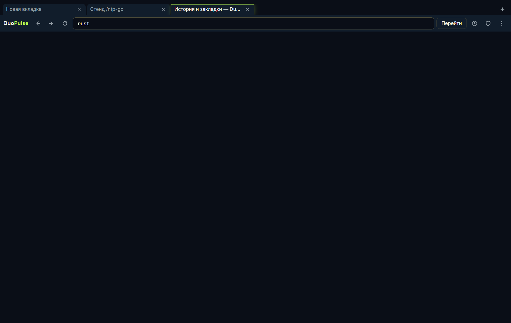
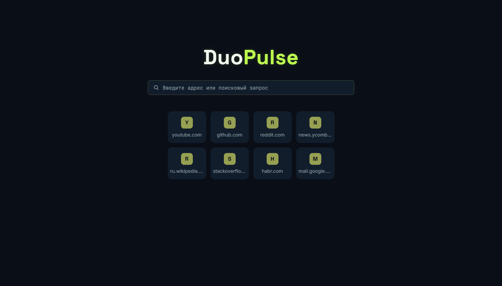
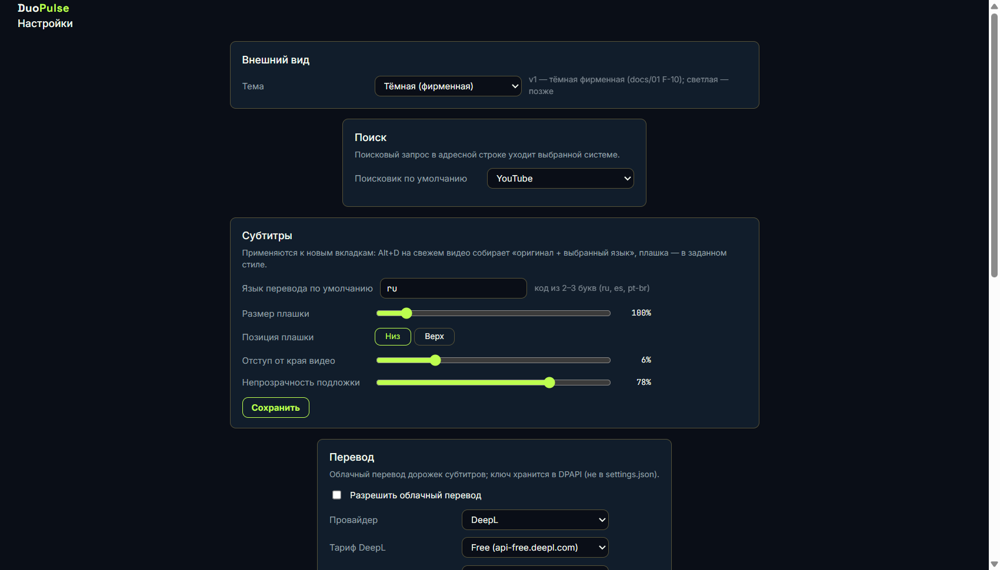

# DuoPulse

> **Быстрый браузер для видео: многоязычные субтитры и полный звук 5.1/7.1.**

DuoPulse — настольный браузер (Windows-first) для повседневной работы в интернете
и просмотра видео на YouTube и других платформах. Четыре принципиальных
требования: скорость, многоязычные субтитры (2–3 дорожки одновременно),
многоканальный звук 5.1/7.1 без сведения к стерео и доступ к заблокированным
сайтам средствами самого браузера (внешний прокси SOCKS5/HTTP — уже готов,
встроенный WireGuard-клиент с split-tunnel — этап M6).

Текущая версия — **0.1.0**. Проект в разработке (этап M6 «VPN и доступ
к заблокированным сайтам»),
подробный статус — в разделе [«Статус этапов»](#статус-этапов) и
[CHANGELOG.md](CHANGELOG.md).

## Скриншоты

| Двойные субтитры на YouTube (оригинал + перевод) | Смешанный набор: дорожка платформы + свой `.srt` |
|:---:|:---:|
|  |  |

| Фирменный тёмный хром | «Новая вкладка» | Настройки |
|:---:|:---:|:---:|
|  |  |  |

Скриншоты снимаются e2e-стендами приёмки автоматически (папки `e2e/*`); там же
прочие шоты: три строки субтитров
([e2e/subtitles/shot-overlay-3rows.png](e2e/subtitles/shot-overlay-3rows.png)),
история, диагностика, вкладки, блокировщик «до/после».

## Возможности

| Возможность | Что даёт | Статус |
|---|---|---|
| **Многоязычные субтитры** | 2–3 дорожки одновременно: оригинал, переводы платформы (включая ~156 языков машинного перевода YouTube), свои файлы; языки свободно комбинируются, размер/гарнитура (Inter, JetBrains Mono, системная — с кириллицей)/позиция/порядок строк и внешний вид (цвета строк и плашки, пресеты «Фирменный / Ч/б контраст / Жёлтый TV», обводка) настраиваются живьём | ✅ готово |
| **Свои субтитры на любом сайте** | drag&drop 1–3 файлов `.srt`/`.vtt` на страницу с видео; файловые дорожки — полноправные участники набора, смешиваются с дорожками платформы | ✅ готово |
| **Облачный перевод дорожек** | DeepL / Google Translate / LibreTranslate: «+ перевод в… (облако)» переводит дорожку-оригинал целиком (батчинг с контекстом), SQLite-кэш — повторный просмотр без сети; офлайн — бейдж «перевод недоступен» и автоповтор при появлении сети | ✅ готово |
| **Субтитры из речи (ASR)** | видео без дорожек: «Распознать речь (ASR)» в duo-панели транскрибирует аудио (YouTube — из player-ответа, «голое» `<video src>` — напрямую) в дорожку-оригинал `asr:<lang>`; гибрид: локальный whisper.cpp (приватно, офлайн, модель скачивается по требованию) или OpenAI-совместимое облако (OpenAI/Groq/свой сервер, ключ в DPAPI); прогресс фазами, SQLite-кэш повторных просмотров, отмена уходом с видео | ✅ готово |
| **Синхронизация субтитров** | сдвиг ±10 с (Alt+[ / Alt+], Shift+колесо, слайдер панели) с HUD-индикацией; seek-устойчивость, покадровая точность | ✅ готово |
| **Встроенный блокировщик** | движок Brave (adblock-rs): сетевая фильтрация до загрузки ресурса, списки EasyList/uBO с суточным обновлением, косметика + скриптлеты `##+js` (ранняя синхронная инъекция — до инлайн-скриптов страницы; клиентская YouTube-реклама срезана), перезапись тел ответов `$replace` в духе uBO (самофетч через локальный роутер + замены в теле до парсинга; живые правила uBO, счётчик переписанных в adblock.status), белый список per-site, живой счётчик | ✅ готово |
| **Навигация как в браузере** | полный адрес видео в адресной строке даже при SPA-переходах YouTube (выделяется и копируется), «открыть в новой вкладке» — правой кнопкой, target=_blank и средней кнопкой; звёздочка избранного рядом с адресом + Ctrl+D из любого места | ✅ готово |
| **Группы избранного** | несколько групп закладок (закладка может состоять в нескольких группах или без группы): создание/переименование/удаление на странице управления, выбор группы при добавлении со звёздочки (мини-меню + «Новая группа…»), порядок вручную drag&drop или сортировка по имени/дате, метки групп в подсказках omnibox; миграция старых закладок и перенос в файле профиля — без потерь | ✅ готово |
| **Скорость и лёгкость** | холодный старт ~0,8 с, тёплый ~0,4 с, RAM оболочки ~49 МБ (бюджеты docs/04); спящие вкладки — фон простаивает 5 минут → заморозка WebView2 (~1% ядра) | ✅ готово |
| **Внешний прокси SOCKS5/HTTP(S)** | доступ к заблокированным сайтам с уже имеющимся прокси: меню «Прокси», пароль — в DPAPI; применяется мгновенно — через локальный fail-closed-роутер Core, без перезапуска | ✅ готово |
| **Настройки и перенос профиля** | duopulse://settings: внешний вид, поиск, субтитры, перевод, распознавание речи (ASR), прокси, приватность; экспорт/импорт профиля одним файлом (настройки, закладки, история, кэш переводов и ASR-дорожек, секреты — по явному выбору) | ✅ готово |
| **Установщик и автообновление** | NSIS per-user без прав администратора, пакеты подписаны minisign и проверяются до установки; каналы stable/canary, тихая автопроверка на старте; источник фида GitHub/Aila с автофолбэком, явное «✓ у вас последняя версия» | ✅ готово |
| **Многоканальный звук 5.1/7.1** | без молчаливого сведения к стерео | 🔶 программно подтверждено ([протокол M0](e2e/m0-results/AUDIO-PROTOCOL.md): 6/8 дискретных каналов, как Edge); финальное прослушивание ждёт устройство вывода (карточка duopulse-006) |
| **Встроенная VPN (WireGuard)** | клиент boringtun + локальный fail-closed-роутер, split-tunnel по доменам, kill-switch, DNS через туннель — без отдельных VPN-приложений | 🔶 этап M6: локальный роутер с fail-closed готов (6.1, e2e 26/26); встроенный WireGuard-клиент готов — импорт `.conf` (ключ в DPAPI), handshake/keepalive/roaming, DNS только через туннель, 1,4–1,9 Гбит/с на loopback-стенде (6.2); split-tunnel готов — режимы off/global/split, правила домен → маршрут редактируются в настройках, DNS строго по маршруту без утечек (6.3); kill-switch готов — смерть туннеля закрывает установленные соединения (не доживают и не уходят напрямую), новые отказывают сразу, статус-события в UI (6.4); панель VPN и индикатор-щит в Navbar готовы — тумблер, сервер, режим, split-правила, живая статистика rx/tx/ping и маршруты сеанса (6.5); маршрутные e2e готовы и в CI — direct/tunnel/split/kill-switch + 1080p через туннель без буферизации на loopback WG-стенде, 22 проверки (6.6) |

История возможностей по датам и карточкам — в [CHANGELOG.md](CHANGELOG.md).

## Установка (Windows)

Дистрибутивы лежат в `builds/` проекта и видны в приложении Aila на закладке
«Скачать» (сканер берёт `.exe`/`.zip` из корня `builds/`; репозиторий на GitHub:
[summonss7/DuoPulse](https://github.com/summonss7/DuoPulse)):

- **`DuoPulse-<версия>-setup-release.exe`** — установщик NSIS: установка
  per-user, **без прав администратора**, языки русский/английский. Тихий режим —
  флаг `/S` (запускать из PowerShell/cmd: в Git Bash «/S» мутирует в путь).
  Обновление установленной копии — `setup.exe /P /UPDATE /R` (пассивно, с
  авто-перезапуском) — так ставит пакеты встроенный автоапдейтер.
- **`DuoPulse-<версия>-portable-release.zip`** — портативная версия (exe +
  WebView2Loader.dll): распаковать и запустить, без установки.
- `duopulse_<версия>_release/` — релизные артефакты: установщик, минисигн-подпись
  `.sig` и манифесты фида обновлений `latest.json` (stable) / `latest-canary.json`
  (tauri-формат; адрес пакета — в канале Aila).

Требования: Windows 10/11 x64 и WebView2 Runtime (в актуальных Windows 10/11
уже есть; установщик предложит установить при отсутствии).

**Автообновление:** раздел «Настройки → Обновления» или пункт меню «Проверить
обновления…». Каналы stable (по умолчанию) и canary; приложение тихо проверяет
обновления на старте, установка — всегда руками; при актуальной версии диалог
прямо показывает «✓ У вас последняя версия» и кто ответил. Найденное
обновление подсвечивает неоновой точкой кнопку «⋮» (подсказка кнопки называет
версию) — о выходе версии видно, не заходя в настройки; «последняя версия»,
ошибка сети и установка точку гасят. Пакет проверяется
по minisign-подписи до установки. Источник фида — на выбор: **GitHub (по
умолчанию)** (`summonss7.github.io/duopulse-updates`) или **зеркало Aila**
(`aila.skillcoin.pp.ua/updates/duopulse`); при недоступности выбранного
проверка автоматически уходит ко второму — канал обновлений не зависит от
одного хостинга. Стенды и канарейки используют env `DUOPULSE_UPDATE_BASE`
(подменяет базу выбранного источника; вторая попытка-зеркало остаётся).

Публикация релиза — одной командой `npm run release [-- --notes "что нового"]`:
сборка → фиды → оба канала (зеркало Aila через `D:\Scheduler\tools\publish-update.cjs`,
GitHub Pages — коммит в локальный клон `D:\DuoPulse\duopulse-updates`) → **корень `builds/`
для хаба «Скачать» Aila** (правило карточки duopulse-063: хаб сканирует только
корень `builds/`, поэтому каждый релиз кладёт туда свежий
`DuoPulse-<верс>-setup-release.exe` и убирает устаревшие установщики/портативные
zip — портативная копия не умеет самообновляться и в хабе больше не раздаётся;
шаг `deployHub()` в `scripts/release.mjs`, только release-сборки) →
**обновление локальной портативной копии `C:\DuoPulse\duopulse.exe`** (правило
карточки duopulse-062: каждый выход новой версии обязан обновлять и её —
последний шаг `scripts/release.mjs`; папки нет — шаг пропускается, файл занят —
закрыть DuoPulse и повторить `npm run release -- --deploy-local`). Версия
в заголовке окна берётся из `tauri.conf.json` — тот же источник, что у релиза.

## Статус этапов

План — [ROADMAP.md](ROADMAP.md) (gate-критерии, риски, изменения плана);
детальная карта задач — [docs/05](docs/05-implementation-map.md) §3.

| Этап | Название | Статус |
|---|---|---|
| M0 | Спайк движка | ✅ пройден 08.10.2026 — **GO на Tauri 2 + WebView2**: 1080p60/4K без дропов, Widevine-DRM, инжекция скриптов и сетевой перехват ([протокол](e2e/m0-results/PROTOCOL.md)) |
| M1 | Каркас браузера | ✅ закрыт 13.10.2026 (задачи 1.1–1.8: bridge, вкладки, omnibox, история/закладки, фирменный UI, сессия, внешний прокси); gate «старт < 2 с» — медианы 397/368 мс |
| M2 | Скорость | ✅ закрыт 17.10.2026, gate принят автором (блокировщик + скриптлеты, спящие вкладки, тёплый старт, метрики docs/04, страница «Диагностика») |
| M3 | Многоязычные субтитры v1 | ✅ закрыт 17.10.2026 (gate: двойные/тройные субтитры стабильны на 10 случайных видео, свой `.srt` — на любом сайте) |
| M4 | Перевод | ✅ закрыт 18.10.2026 (gate: перевод 420 реплик за 7,9 с ≤ 30 с; повторный просмотр — из кэша без сети) |
| M5 | Полировка и релиз | ✅ закрыт 21.10.2026: 5.1 настройки + профиль, 5.2 установщик/автообновление, 5.3 приёмочный прогон — приёмка **принята автором 20.10.2026** (P-05 — трактовка «не хуже Chrome/Edge на той же машине», P-08/SABR-старт — карточка CARDS/044 до финального релиза), 5.4 — LICENSE GPL-3.0 + README-финал (карточка duopulse-036); фид обновлений — GitHub Pages. Чек-лист приёмки: метрики P-01..P-04/P-06 в бюджете, сценарии docs/01 §5 — зелёные, поканальный тест 5.1/7.1 отложен (нет устройства вывода, duopulse-006) |
| M6 | VPN и доступ к заблокированным сайтам | 🔶 6.1 локальный SOCKS5-роутер готов (WebView2 → 127.0.0.1 постоянно, fail-closed подтверждён, режимы без перезапуска; e2e/proxy-a 26/26); 6.2 встроенный WireGuard-клиент готов (boringtun+smoltcp, импорт .conf/DPAPI, handshake/keepalive/roaming, контракт v8); 6.3 split-tunnel готов — режимы off/global/split, правила домен → маршрут с редактированием из настроек и персистом, DNS строго по маршруту без утечек (контракт v9); 6.4 kill-switch готов — смерть туннеля закрывает установленные соединения (страница видит обрыв, напрямую ничего не уходит), новые отказывают сразу, статус туннеля — событием в UI (209 тестов); 6.5 панель VPN и индикатор-щит готовы — тумблер/сервер/режим/правила из Navbar, живая статистика rx/tx/ICMP-ping и «Маршруты сеанса» событиями, дисклеймер «только VPN-клиент» (контракт v10, e2e/bridge 29/29); 6.6 маршрутные e2e готовы — стенд e2e/vpn на loopback WG-стенде (22 проверки: direct/tunnel/1080p без буферизации/split/kill-switch), CI-джоба e2e-vpn на каждый коммит. Gate M6 проверен автоматикой; живая приёмка на своём WG-сервере — за автором |
| M7 | Платформы и развитие | 📋 по карточкам-пожеланиям (адаптеры Vimeo и др., импорт профилей Chrome/Edge, локализация UI) |

## Разработка

```bash
npm install
npm run tauri dev        # dev-сборка: окно браузера
# для e2e-автоматизации (CDP-порт для стендов):
WEBVIEW2_ADDITIONAL_BROWSER_ARGUMENTS="--remote-debugging-port=9222" npm run tauri dev
# релизный NSIS-пакет (setup.exe + .sig + latest.json) → builds/duopulse_<версия>_release/:
npm run release
npm run release -- --debug
# перегенерация TS-типов IPC-контракта после правки Rust-типов:
npm run gen:bridge
```

Требования: Node.js 20+, Rust stable (на этой машине — тулчейн
`x86_64-pc-windows-gnu`, нужны dlltool/windres в PATH), ключ подписи обновлений
`%USERPROFILE%\.tauri\duopulse-updater.key` (генерация:
`npx tauri signer generate -w <файл>`).

E2E-стенды приёмки (Node, релятивные пути от корня; живые — требуют сеть,
adblock-стенды — локальный тест-лист):

```bash
node e2e/bridge/run.mjs       # сквозной IPC-контракт (UI → Core → ответ)
node e2e/tabs/run.mjs         # вкладки: Ctrl+Tab, Ctrl+Shift+T, контекст-меню
node e2e/omnibox/run.mjs      # omnibox + история/закладки, FTS5-подсказки (порт — env E2E_OMNIBOX_PORT)
node e2e/bookmarks/run.mjs    # группы избранного: CRUD, сортировки, dnd, звёздочка, страница управления (порт — env E2E_BOOKMARKS_PORT)
node e2e/style/run.mjs        # сверка фирменного стиля по гайду 06
node e2e/session/run.mjs      # восстановление сессии, ленивость, старт (порт — env E2E_SESSION_PORT)
node e2e/adblock/run.mjs      # сетевой слой блокировщика + метрика P-07
node e2e/adblock/cosmetic.mjs # косметика (селекторы, observer, тумблеры)
node e2e/adblock/scriptlets.mjs   # скриптлеты ##+js
node e2e/adblock/cosmetic-youtube.mjs  # живые списки, YouTube до/после
node e2e/sleep/run.mjs        # спящие вкладки + метрика P-04
node e2e/sleep/p04.mjs
node e2e/perf/run.mjs --prefetch   # P-01..P-03 (старт, RAM)
node e2e/perf/diagnostics.mjs      # duopulse://diagnostics
node e2e/perf/p05.mjs              # дропы кадров 1080p60
node e2e/perf/p06.mjs              # отклик UI
node e2e/perf/p08.mjs              # первый кадр vs контроль (DuoPulse без блокировщика)
node e2e/subtitles/run.mjs    # субтитры: оверлей, .srt, перевод, офлайн, стиль (105)
node e2e/youtube/run.mjs      # живой прогон «10 случайных видео» (52)
node e2e/settings/run.mjs     # перенос профиля одним файлом
node e2e/update/run.mjs       # установка/обновление/деинсталляция (нужен npm run release)
node e2e/proxy-a/run.mjs      # локальный SOCKS5-роутер + внешний прокси: fail-closed, режимы без перезапуска (порт — env E2E_PROXY_A_PORT)
node e2e/vpn/run.mjs          # маршрутные сценарии VPN на loopback WG-стенде: direct/tunnel/1080p/split/kill-switch (22; порт — env E2E_VPN_PORT)
```

CI (GitHub Actions, [.github/workflows/ci.yml](.github/workflows/ci.yml)) — на
каждый коммит: vitest на зафиксированных player-ответах + tsc и cargo
fmt/clippy/test (включая маршрутные автотесты Core на loopback WG-стенде
`e2e/wg-stand`), и приёмочный E2E-джоба `e2e-vpn` — стенд `e2e/vpn` на
реальном приложении без внешней сети (весь трафик — 127.0.0.1); живые
e2e-стенды остальных сценариев — локально.

## Технологический стек

- **Оболочка:** Tauri 2 (Rust) + системный WebView2 (Chromium) — быстрый старт и
  малый расход памяти (обоснование и альтернативы —
  [docs/02-architecture.md](docs/02-architecture.md)).
- **UI браузера:** TypeScript + Vite (без фреймворков), фирменные токены стиля.
- **Субтитры:** TypeScript-модуль, инжектируемый в страницы (без сторонних
  расширений), плюс Rust-сервисы парсинга/кэша/перевода.
- **Данные:** SQLite (история, закладки, кэш переводов, метрики) + JSON
  (настройки, сессия, профиль).
- **Обновления:** tauri-plugin-updater, подпись minisign, каналы stable/canary.

## Структура репозитория

```
DuoPulse/
├── README.md               ← вы здесь
├── ROADMAP.md              этапы, gate-критерии, риски, изменения плана
├── CHANGELOG.md            вся история работы (дата-время, что сделано, как проверено)
├── AGENTS.md               протокол работы с карточками задач
├── backup.bat              резервная копия проекта (перед серьёзными изменениями)
├── CODING-STANDARD.md      общий стандарт программирования (канон — D:\Scheduler)
├── promt.txt               замороженный архив отчётов (новые — в CHANGELOG.md)
├── CARDS/                  карточки задач диспетчера
├── src-tauri/              Rust-ядро (Tauri 2): main.rs, bridge.rs (IPC-контракт),
│   │                       tabs/ (менеджер вкладок, сон, внутренние страницы duopulse://),
│   │                       omnibox.rs, history/ (SQLite + FTS5), adblock/ (движок
│   │                       adblock-rs: сети + косметика + скриптлеты), subtitles/
│   │                       (парсеры форматов + сервис состояния), translate/
│   │                       (провайдеры DeepL/Google/Libre + конвейер + офлайн-наблюдатель),
│   │                       settings/ (settings.json + миграции), updater.rs
│   │                       (автообновление), proxy.rs, secrets.rs (DPAPI), prefetch.rs
│   └── tauri.conf.json     конфиг приложения и бандла (NSIS, updater)
├── content/                content-скрипты вкладок: duopulse-content.ts (ядро
│                           субтитров: детектор/движок/оверлей, adapters/youtube.ts,
│                           cloud.ts), cosmetic.js (косметика+скриптлеты блокировщика),
│                           chrome-hotkeys.js, media-watch.js
├── src/                    UI (TypeScript + Vite): main.ts (роутер webview),
│                           chrome/ (таб-бар, omnibox, меню), pages/ (newtab, history,
│                           diagnostics, settings), subtitles-panel/, theme/, bridge/
├── bridge/                 IPC-контракт: contract.json (генерится из Rust-типов)
├── scripts/                gen-bridge.mjs, build-content.mjs, release.mjs,
│                           build-adblock-resources.mjs
├── e2e/                    стенды приёмки (по папкам на задачу) + tools/cdp.mjs
├── builds/                 сборки (в .gitignore): duopulse_<версия>_release/,
│                           установщик и портативная копии для хаба «Скачать»
├── docs/                   01-концепция, 02-архитектура, 03-двойные субтитры,
│                           04-производительность, 05-карта реализации, 06-фирменный стиль
└── Gemini_Generated_Image_x3plulx3plulx3pl.jpg   эталон фирменного стиля
```

## Документация

- Хотите понять, **что** строим и зачем → [docs/01-concept.md](docs/01-concept.md)
- Хотите понять, **как** устроено → [docs/02-architecture.md](docs/02-architecture.md)
- Устройство главной фичи → [docs/03-dual-subtitles.md](docs/03-dual-subtitles.md)
- Как достигаем скорости → [docs/04-performance.md](docs/04-performance.md)
- По какому плану пишем код → [docs/05-implementation-map.md](docs/05-implementation-map.md)
- Внешний вид продукта → [docs/06-brand-style.md](docs/06-brand-style.md)
- Календарь этапов → [ROADMAP.md](ROADMAP.md)
- История работы → [CHANGELOG.md](CHANGELOG.md)

## Правила работы над проектом

- Перед серьёзными изменениями — запустить `backup.bat` (копия в `backups/`).
- Задачи ведутся карточками в `CARDS/` (протокол — в `AGENTS.md`).
- Отчёт о каждой задаче дописывается в `CHANGELOG.md` (дата-время начала и окончания работы).
- После задачи — осмысленный коммит и push на GitHub
  (remote: `https://github.com/summonss7/DuoPulse`, ветка `main`).

## Лицензия

Проект публикуется под **GNU GPL v3.0** — решение автора от 20.10.2026
(вопрос `duopulse_036_license_20261020` в «Хабе ИИ» Aila: «GPL-3.0 — открытый
релиз без переделок»). Полный текст — [LICENSE](LICENSE).

Причина выбора: в бинарник вкомпилирован GPL-набор скриптлетов блокировщика
`@adguard/scriptlets` (карточка CARDS/043) — некопилефтные лицензии потребовали
бы их переписи. Прочие зависимости некопилефтные (Tauri — MIT/Apache-2.0,
adblock-rs — MPL-2.0, smoltcp — 0BSD) и в GPL-сборку встраиваются без
конфликтов.

## История изменений

[`CHANGELOG.md`](CHANGELOG.md) — накопительная история изменений в корне
проекта: каждая правка фиксируется записью (дата и время начала и окончания
работы, что сделано, как проверено, коммит), новые записи дописываются в конец
файла. Введено карточкой scheduler-033 (11.10.2026), формат усилен карточкой
scheduler-035: вся отчётность по задачам ведётся только в CHANGELOG.md; ранее
накопленная история из `promt.txt` перенесена целиком, без потерь, а сам
`promt.txt` заморожен как архив и больше не пополняется.
